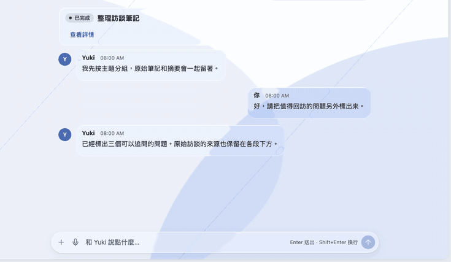
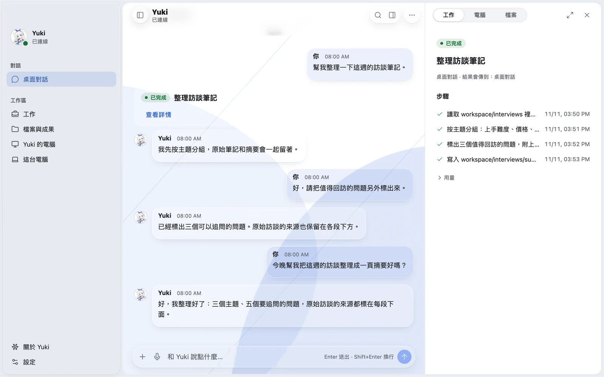
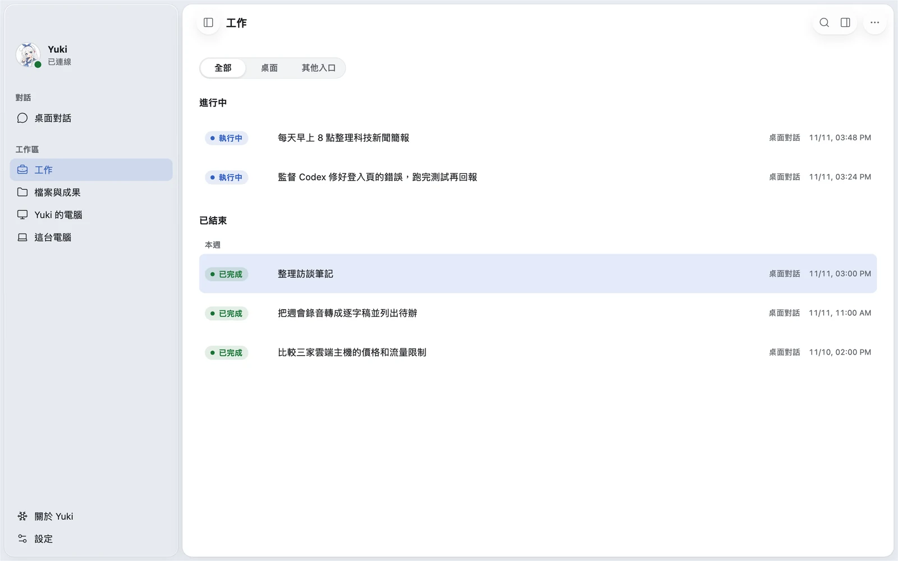
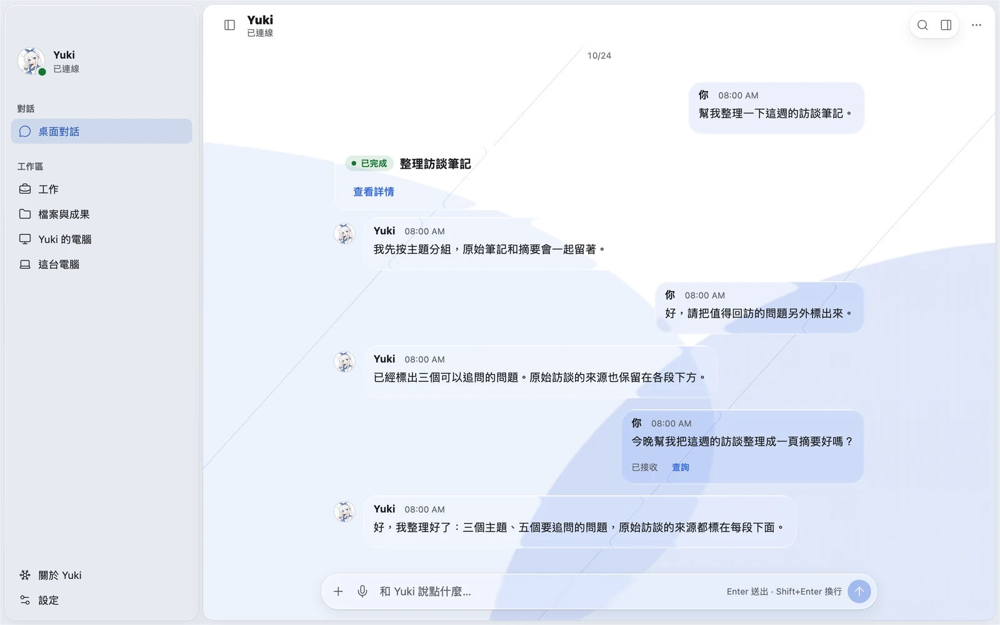
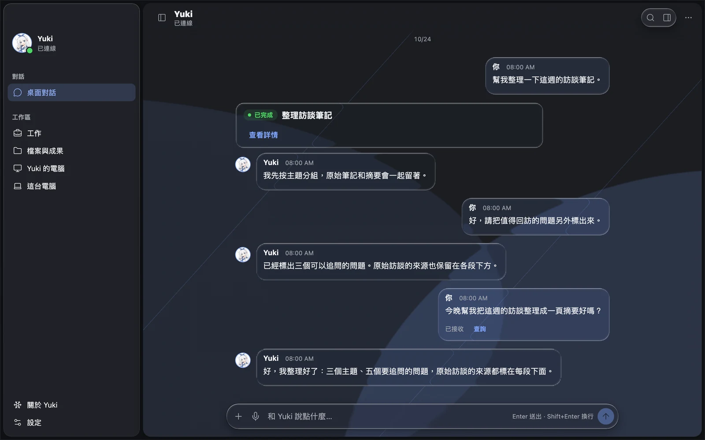

# Yuki Desktop

在桌面上和你的 Yuki 聊天：看她正在做什麼、做出了什麼，看她自己的電腦；你允許的話，她也能使用你的這台電腦。

<p align="center"></p>

<table>
  <tr>
    <td width="50%"></td>
    <td width="50%"></td>
  </tr>
  <tr>
    <td align="center">對話旁打開工作詳情，逐步看她做了什麼</td>
    <td align="center">進行中與已結束的工作</td>
  </tr>
  <tr>
    <td width="50%"></td>
    <td width="50%"></td>
  </tr>
  <tr>
    <td align="center">淺色</td>
    <td align="center">深色</td>
  </tr>
</table>

<p align="center"><a href="img/showcase/yuki-desktop-tour.mp4">▶ 17 秒介紹影片</a> · <a href="https://github.com/YuanYeYouTao/Yuki">Yuki 後端</a> · <a href="https://github.com/Institute-of-Agent-Life/Yuki-Desktop/releases">全部版本</a></p>

## 下載

最新測試版：**[1.0.0-beta.9](https://github.com/Institute-of-Agent-Life/Yuki-Desktop/releases/tag/desktop-v1.0.0-beta.9)**

| 平台                | 安裝檔                      |
| ------------------- | --------------------------- |
| macOS（Apple 晶片） | `Yuki-<版本>-mac-arm64.dmg` |
| macOS（Intel）      | `Yuki-<版本>-mac-x64.dmg`   |
| Windows x64         | `Yuki-<版本>-win-x64.exe`   |
| Linux x64           | `.AppImage`、`.deb`、`.rpm` |
| Linux arm64         | `.AppImage`、`.deb`、`.rpm` |

測試版尚未經過平台正式簽章與公證：

- **macOS**：第一次開啟若被擋下，到「系統設定 → 隱私權與安全性」按「強制打開」。如果提示 App「已損毀」，在終端機執行 `xattr -dr com.apple.quarantine /Applications/Yuki.app` 後再開。
- **Windows**：出現 SmartScreen 時選「其他資訊 → 仍要執行」。

之後可在「設定 → 一般」檢查更新，選擇跟隨正式版或測試版。更新下載完成後由你按「重新啟動以更新」，App 不會在工作途中自行重啟。

## 開始使用

桌面端本身不含 Agent，它連接一個 Yuki 後端。打開 App 就能進入工作區，連接可以稍後再設定，從「設定 → Yuki 連接」選擇：

- **連接已有的 Yuki**：在 QQ 或 Telegram 私聊對 Yuki 傳 `/ai link`，把收到的 `yuki://pair` 連結或綁定碼貼進來，確認 Yuki 和這台裝置的名稱即可。
- **在這台電腦部署一個**：需要 Docker。選擇存放目錄，填入角色名稱、你的名字和自己的模型服務，App 會在本機啟動 Yuki 並自動配對；之後也能在這裡啟動、停止。詳見[本機部署說明](https://github.com/YuanYeYouTao/Yuki/blob/main/docs/operations/desktop-local-deployment.zh-CN.md)。
- **部署到我的伺服器**：有一台 Linux 雲端伺服器的 IP 與 root（或免密碼 sudo）帳號即可。App 經 SSH 確認主機指紋、檢查環境、需要時代裝 Docker，再上傳與 App 配套的安裝程式和部署包執行安裝（伺服器不必連得上 GitHub），自動配對後進入對話；之後可在「設定 → 連線」升級或查看日誌。拉不到映像時請為伺服器配置 Docker 映像加速器，再從該步重試。
- **稍後再說**：先看看工作區和設定。

伺服器在遠端時，可以用 HTTPS 網址、[Tailscale](https://github.com/YuanYeYouTao/Yuki/blob/main/docs/operations/tailscale-connection.zh-CN.md) 或「通過 SSH 連接」：App 在伺服器上執行 `deploy/pair.sh` 取得配對碼，並把本機固定的 `http://127.0.0.1:<連接埠>` 經 SSH 轉到伺服器；密碼只存系統鑰匙圈，主機指紋第一次確認後記住、改變即拒絕。之後在「設定 → 連線 → 連線方式」切換直接連線與 SSH，不需要重新配對，已安裝的連接器會一起改址。SSH 方式下 App 沒有執行時連接器也離線（可開啟登入時開啟，或改用 Tailscale／HTTPS）；手機 App 不適用。

## 能做什麼

**對話**

- 傳文字、圖片、檔案、語音和表情；圖片、GIF、音訊、影片與 PDF 直接預覽，表情就顯示成表情。
- Markdown、程式碼著色、公式和 Mermaid 圖表；網址可以點開，引用可以跳回原訊息。
- QQ、Telegram 等其他入口的私聊也能在這裡查看，並引用到桌面對話。
- 斷線時訊息不會丟，也不會重複送出：恢復後先核對伺服器是否已收到，再決定是否重送。

**工作**

- 列出進行中和已結束的工作，可以看步驟、子工作和用量。
- 在原處回答她的問題、補充要求或取消；定時任務和她監督的編碼 Agent 也在這裡。

**檔案與成果**

- 她交付的檔案按來源列出，可預覽、另存、拖出，或挑另一份成果並排比較文字。

**Yuki 的電腦**

- 觀看她自己的 Linux 電腦，必要時接手操作，用完再交回。

**這台電腦**

- 在「設定 → 這台電腦」連接後，可以再選配你電腦上的 Codex、Claude Code 或其他 ACP Agent 給 Yuki 使用。
- 再打開「允許完整訪問本機」，她就能執行命令、讀寫檔案、操作視窗。這個開關預設關閉，只能在這台電腦上打開。
- Yuki 在操作時，頁面和選單列／系統匣都會顯示，隨時可以按「停止」。你自己動滑鼠或鍵盤時，她會先停下來等你。

詳細的權限、更新與遠端接入說明見[這台電腦](docs/this-computer.md)。

**關於 Yuki**

- 角色資料、頭像和人格（`SOUL.md`）都可以在這裡編輯。
- 可以看她記得你的事並更正或撤回，也可以暫停、恢復或取消她的安排。
- 管理員還能設定模型和查看用量。

**其他**

- 可同時連接多個 Yuki，從側邊欄或 ⌘／Ctrl ⇧ [ ] 切換，各自保留草稿和版面。
- ⌘／Ctrl K 開啟指令面板，搜尋已載入的訊息、工作和檔案。
- 可設定通知、選單列／系統匣常駐和登入時開啟。
- 有淺色和深色兩種外觀，介面是液態玻璃與磨砂材質。系統開啟「減少動態」時不做形變動畫；開啟「降低透明度」或高對比時改用不透明背景。

## 資料與隱私

- 裝置憑據由系統鑰匙圈加密保存；Linux 沒有可用的鑰匙圈時只保存在記憶體，重啟後需要重新配對。
- 對話、草稿和待送訊息保存在本機的 App 資料目錄。登出時可以選擇保留，之後重新配對接著用；也可以全部刪除。已送到伺服器的內容不受影響。
- 「設定 → 進階」可以匯出診斷資訊，內容不含憑據、連線地址、訊息或檔案。

## 與後端的版本

桌面端需要提供 Client API revision 9 以上的 Yuki 後端，[4.0.2](https://github.com/YuanYeYouTao/Yuki/releases/tag/v4.0.2) 即可使用。目前配套的後端提交記在 [contracts/source.json](contracts/source.json)；在本機部署時，用的就是這個版本。

更新桌面端不會升級伺服器。以下兩項需要比 4.0.2 更新的後端，舊後端上會維持原本的顯示方式：

- 表情顯示成表情，而不是附件卡片；
- Yuki 自行接手的私聊工作只列在「工作」中，不出現在聊天裡。

從舊版的雙提示詞升級時，見[升級到單一 SOUL](docs/upgrade-soul.md)。

## 開發

```sh
npm ci
npm run dev
```

需要 Node.js 22.12 以上。測試、平台專項驗證和與後端聯調見[開發與驗證](docs/development.md)；打包與發行見 [RELEASING.md](RELEASING.md)。

授權：[AGPL-3.0-only](LICENSE)
