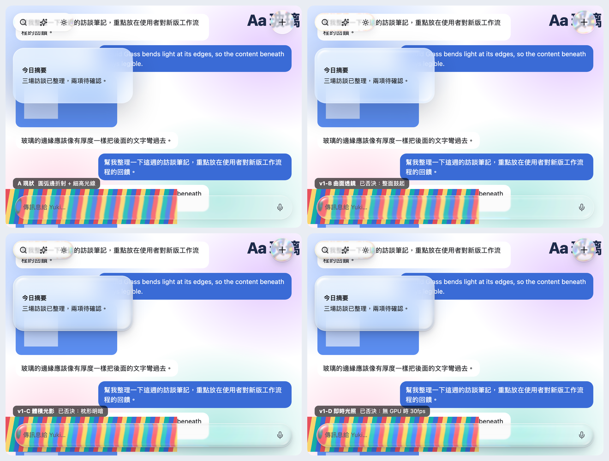
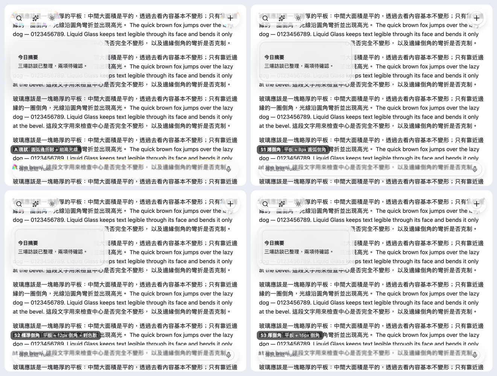
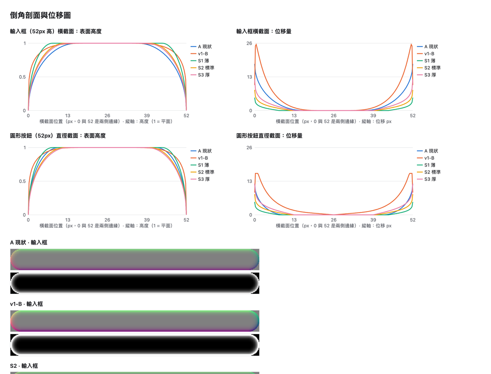
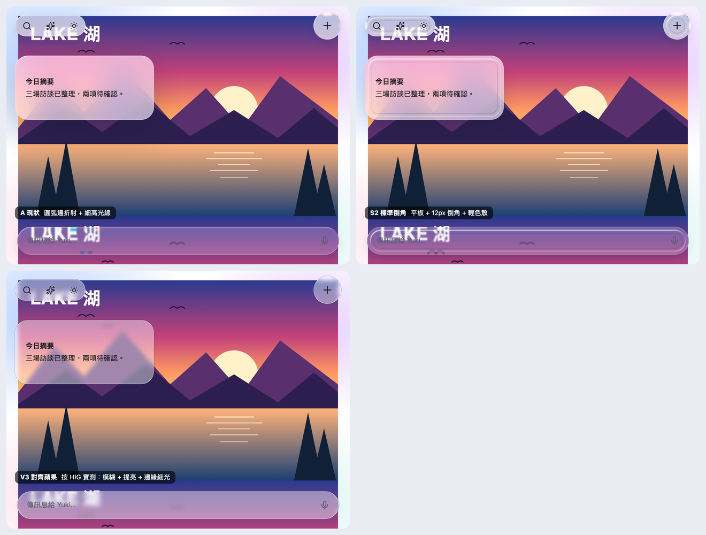
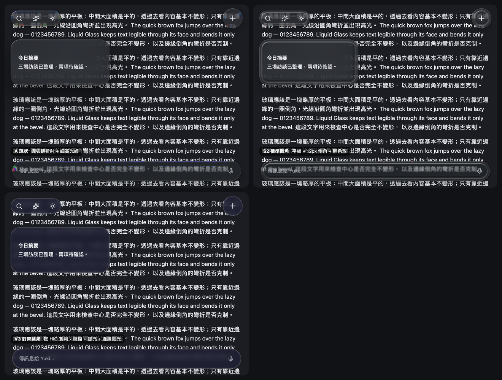
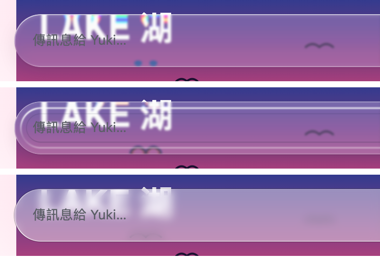
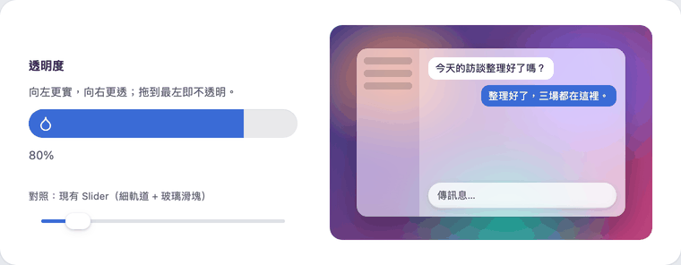

# 液態玻璃質感與透明度滑塊調研（2026-11-23）

本報告只做調研與原型，不改正式介面。原型是測試 fixture 頁，不接入應用；結論與數字以這份報告為準，正式實作另開任務。

## 1. 怎麼看原型

```sh
npm ci
node node_modules/vite/bin/vite.js --config tests/fixtures/vite.config.ts
# 瀏覽器打開 http://127.0.0.1:4178/liquid-glass-lab.html
```

| 網址參數 | 內容 |
|---|---|
| `?v=all&set=v3` | 現狀、S2、V3 並排（`set=v1`：第一輪三案；不帶 `set`：第二輪平板四案） |
| `&bg=text\|photo\|chat`、`&theme=dark` | 底下是整段文字、彩色圖片或聊天，淺色或深色 |
| `?v=<方案>&solo=1&animate=1` | 單一方案填滿視窗，內容在玻璃下持續捲動（量幀耗時用） |
| `?page=profile` | 倒角剖面曲線與位移圖本身 |
| `?page=disc` | 仿 HIG Materials 圓盤的對照頁（量測工具用） |
| `?page=slider` | iOS 式透明度滑塊與即時預覽 |

E2E：`YUKI_LAB_OUTPUT=<目錄> npx playwright test tests/e2e/liquid-glass-lab.spec.ts`。沒有設這個變數時整個檔案跳過，所以不進 CI。全部截圖、`frame-budget.json`、合成器 trace 和滑塊的逐幀圖都會寫到這個目錄。量測蘋果素材的工具在 `tools/`（蘋果素材有版權，不進倉庫，見 `tools/README.md`）。

## 2. 現狀

- **渲染**：`src/renderer/materials/glass.ts`。每塊玻璃有一個 SVG filter，掛在 CSS `backdrop-filter: url(#…)`（只有 Chromium 支援），裡面是 `feImage` 位移圖接 `feDisplacementMap`。位移只在邊緣一圈（`presets` 的 bezel 寬 5–20px、bend 7–18px，剖面是圓弧 `1 − √(1 − e²)`），小控件另有中心放大。只有浮在內容上的 toolbar 和 composer 會做色散，把 R、G、B 三個通道分別位移後再合成。
- **貼圖**：圓角矩形沿直邊的形狀處處相同，所以每種玻璃只畫一塊略大於圓角的切片，任意尺寸都由切片拼出來；高光圖用 `-webkit-mask-box-image` 鋪在邊上。
- **邊光**：`materials.css` 的 `::after` 是一個以指標為中心的徑向漸層，再用各塊玻璃的高光圖遮罩。
- **材質層級**：`--glass-lens` 是 `blur(1px)`，`--glass-pane` 是 `blur(24px) saturate(160%)`，`--glass-clear` 給媒體上的控制用；面上再疊白色或深色的半透明 tint（例如 composer 的 16%、`--mat-pane` 的 60%）。
- **透明度**：只有 `Preferences.opaque` 一個布林值。設定頁的「視窗材質」是兩段的 Segmented（毛玻璃／不透明）；主程序 `window-appearance.ts` 依它切換 vibrancy 或 Mica；渲染端設定 `data-opaque`。系統的減少透明度和高對比也會強制不透明。
- **效能預算**（`tests/e2e/glass-slices.spec.ts`）：
  - 首次開啟一塊玻璃，貼圖耗時 ≤30ms；再次開啟 ≤2ms；隨視窗縮放每一步 ≤4ms。
  - 任何長任務都不得超過 100ms。

## 3. 蘋果 Liquid Glass 的構成

先列官方說法，再列我們在 HIG 圖和 WWDC25 影片幀上量到的數字。量測方法和對照圖見第 6 節。

| 構成 | 官方說法 | 實測（HIG Materials、WWDC25 219） |
|---|---|---|
| 透鏡（lensing） | 形狀靠「即時彎折、匯聚光線」立起來，取代傳統的散射模糊（WWDC25 219）。 | 網格透鏡：中心的線條位置不變。倒角約 0.16R，位移約 0.2R，剖面 (1−t)^1.5，線條在倒角裡被拉成貼著邊緣的弧。Snell 圓弧剖面擬合得明顯較差。 |
| 尺寸 | 元素越大，材質越「厚」：陰影更深、透鏡更強（219）。 | 大透鏡的倒角和圓角成比例。小控件沒有可量的素材。 |
| 模糊 | regular 會模糊並調整亮度，clear 高度透明（HIG Materials）。 | regular 等效 σ ≈ 4.3pt（我們的 pane 是 24px，約 6 倍；lens 是 1px）。 |
| 明暗自適應 | regular 在暗背景上更暗、在亮背景上更亮（HIG）。 | 淺色：面上 L* 84（約 40% 白色霧化，鮮豔度降為 0.5 倍）。深色：L* 10.7 的深藍灰，幾乎不透出背景，鮮豔度 1.34 倍。 |
| 高光 | 光沿輪廓移動、隨裝置運動（219）。 | 一條 0.5–1pt 寬的線，緊貼邊緣內側。左上、右下兩個對角最亮，左邊和下邊較弱。強度隨背景變：淺色 +5 到 +9，深色 +19 到 +29，clear +16 到 +36 L*。深色時還有一圈向內約 1pt 衰減的光暈。 |
| 陰影 | 陰影隨背後內容調整（219）。 | HIG 圓盤沒有投影。淺色背景時盤外有一條 0.5pt 的細暗環（−7 到 −10 L*）。WWDC 演示裡浮起的按鈕有柔和投影。 |
| 色散 | 官方資料沒有提到。 | 幾乎沒有，只有網格透鏡右緣有極淡的彩邊。 |
| 中心放大 | 沒有提到。 | HIG 的 clear 圓盤頻譜擬合出約 1.55 倍放大。 |
| 互動 | 按下時從內部發光、縮放並回彈（219、323）。 | 分享按鈕按下放大約 1.14 倍並強烈提亮；鬆手約 0.16s 回到原尺寸，亮度約 0.4s 退完，看不出過衝。 |

## 4. 方案演進

### v1：三個加強形狀的方案（已否決）



- B 曲面透鏡：squircle 曲面配 Snell 折射，倒角加寬，按鈕中心放大。
- C 體積光影：在 B 之上加法線打光、背光邊和內外陰影。
- D 即時光照：在 C 之上加 `feSpecularLighting`，光源跟隨指標。

所有者看圖後的回饋是「像鼓起來的泡泡或透鏡」。看剖面與位移圖（`?page=profile`）可以找到三個原因：

1. **倒角太寬。** 輸入框的倒角 22px，佔半高 26px 的 85%；按鈕 20px，佔半徑 26px 的 77%。幾乎整面都是曲面，看起來就是一個圓頂。
2. **按鈕的中心放大按到中心的距離計算。** 位移裡的 `zoom·x/hx` 一項讓整面都在動，那就是一枚放大鏡。位移本身是按 SDF 算的，凸起不是 SDF 的問題。
3. **明暗是枕形的。** 寬倒角上的 Blinn-Phong 打光、整圈陰影、`inset` 光暈和由上而下的漸層，疊出來的就是枕頭或圓頂的明暗。

另外，D 的即時光照在軟體合成下只有 30fps，見第 5 節。

### v2：平板加圓角倒角（所有者給的方向）




- 中心是平台，位移為 0。只有到邊緣的有號距離小於倒角寬時才彎折，剖面是 1/4 圓 `h = √(1 − (1 − d/b)²)`，法線取 SDF 自己的梯度。
- S1 倒角 8px，S2 12px 加輕色散，S3 16px。倒角不超過圓角的 60%，也不超過短邊的 1/4。
- 倒角中段有一條面向光的細鏡面線，外緣一條細線，內側有淡反光，倒角盡頭一條極細暗線，底部有柔和投影。
- E2E 驗證：面上位移值 ≤1/127，倒角符合上限。

### v3：逐項對齊蘋果（推薦）





v3 沿用 v2 的平板形狀，但每個參數都換成實測值，再一輪對比、一輪調參，共五輪：

- **形狀**：倒角 = 0.16 × min(圓角半徑, 短邊/2)，最小 3px；位移 = 1.25 倍倒角寬，剖面 (1−t)^1.5。52px 的圓按鈕和輸入框約 4px，157pt 的圓盤 12.6px。
- **材質**：一律用 regular。
  - 淺色：`blur(4.25px) brightness(1.04)`，加 42% 白色 tint。
  - 深色：`blur(6px) saturate(1.15)`，加 rgb(30 32 50 / .85)。
  - 媒體上的 clear：`blur(2px) saturate(.8)`，加 3% 白色。
- **邊光**：邊緣內 0.45px 一條 0.5px 寬的線，對角瓣用 `|2·nx·ny|²` 加權，下沿再加亮。淺色線強 0.5，盤外加 0.5px、30% 的暗環；深色線強 0.24，再加一圈向內 1.3px、強度 0.16 的光暈。
- **不做**：色散、內暗線、投影（應用裡要不要留輕投影，待所有者決定）。

## 5. 效果與效能對比

量測條件：無頭 Chromium 156（軟體合成，相當於沒有 GPU 合成的機器）、2x、1200×760。內容在玻璃下持續捲動，指標同時掃過。合成器單幀耗時取 trace 裡的 `Display::DrawAndSwap`。

| 方案 | 貼圖（4 塊玻璃合計） | 合成器單幀 p50 / p95 | 掉幀（>20ms） | >100ms 長任務 |
|---|---|---|---|---|
| 無玻璃 | 0 | 3.8 / 4.2ms | 0 | 0 |
| A 現狀 | 9.8ms | 11.0 / 11.4ms | 0 | 0 |
| v1 B 曲面透鏡 | 13.2ms | 11.1 / 11.5ms | 0 | 0 |
| v1 C 體積光影 | 22.1ms | 10.9 / 11.3ms | 0 | 0 |
| v1 D 即時光照 | 27.1ms | **24.1 / 24.7ms** | **185／400 幀**（約 30fps） | 0 |
| v2 S1 薄倒角 | 14.2ms | 7.2 / 7.6ms | 0 | 0 |
| v2 S2 標準倒角＋色散 | 14.7ms | 14.0 / 14.4ms | 0 | 0 |
| v2 S3 厚倒角 | 16.4ms | 7.3 / 7.6ms | 0 | 0 |
| **v3** | **9.3ms** | **6.7 / 6.9ms** | 0 | 0 |

- 有頭 Chromium 走 GPU（Apple M 系列）時，每個方案的 CPU 端合成都不到 1ms，SwapBuffers 約 1ms。差異只在沒有 GPU 合成時才看得出來。
- 色散是最貴的一項：三次位移再加合成，S2 因此比 S1 多 7ms。
- v3 比現狀省，因為沒有色散，常規材質的模糊也比 pane 的 24px 小。

## 6. 與蘋果逐項的差距

對照方式是蘋果在左、v3 在右，用 HIG 圓盤和 WWDC 幀，在相同背景、相同幾何下渲染。數字為 v3 對蘋果。

| 項 | 結果 |
|---|---|
| 模糊 σ | 8.9 對 8.5（2x px）：一致 |
| 面上亮度 L* | 淺色 83.4 對 84.2，深色 10.9 對 10.7，clear 33.8 對 33.3：一致 |
| 鮮豔度 | 淺色 0.55 對 0.49；深色 1.54 對 1.34，偏豔，可把 saturate 降到 1.0（未複測） |
| 高光 | 位置和寬度一致；各方向強度誤差 ≤5.5 L*。淺色的左邊偏亮 3、下邊偏暗 4.6 |
| 外側暗環 | 淺色 −5.9/−11.8 對 −7.3/−9.8：接近 |
| 折射 | 網格透鏡竪線軌跡 RMS 2.2px：一致。地平線膠囊那段演示的位移強四倍以上，與網格那段互相矛盾，我們取保守值 |
| **說不清** | 小尺寸控件的倒角比例（沒有可量素材）；clear 的模糊與放大互相耦合 |
| **有意不同** | HIG clear 圓盤的 1.55 倍中心放大（與「中心不形變」的方向衝突） |
| **仍有差距** | 高光不能隨背後亮度自動變化，只能按主題切兩組參數，這是 `backdrop-filter` 讀不到背景亮度的限制；按壓動態沒有改（我們放大 1.03–1.08 且有過衝，蘋果 1.14、提亮更強、無過衝） |

## 7. iOS 式透明度滑塊



- **樣式**：參照控制中心，粗膠囊軌道（32px），以填充表示數值，沒有滑鈕。
  - 按下時膨脹：高度 +16%、寬度 +3.5%。
  - 拖出兩端時，往拖動方向拉長、同時變細（`tanh` 橡皮筋），放手後以欠阻尼彈簧回彈。
  - 相對拖動：按在任何位置都不會跳值。
  - 鍵盤方向鍵每次 ±5。
  - 減少動態效果時，不做膨脹和拉伸。
- **即時預覽**：旁邊是一個小視窗樣張（桌面圖片、側欄、對話、輸入框），每次移動都立即重算透明度、模糊與 tint，不等放手。拖到 0 時，樣張立刻換成實色。
- **E2E 驗證**：
  - 按下不跳值。
  - 20 步拖動得到 17 個不同的值。
  - 越過左端停在「不透明」。
  - 拉伸後回到 `matrix(1, 0, 0, 1, 0, 0)`。
- **接入現有設定**（建議，刪除優先）：
  - **儲存**：`Preferences.opaque: boolean` 換成 `transparency: number`（0–100），不保留兩個欄位。
    - 舊資料遷移：`opaque: true` 轉成 0，`false` 轉成預設值。
    - `diagnostics.ts` 一併改成記錄數值。
  - **IPC**：`yuki:preferences` 改收 `transparency`，限制在 0–100 的有限數。
  - **主程序**：`window-appearance.ts` 只在 0 和大於 0 之間切換 vibrancy、Mica 與背景色。
    - 系統的減少透明度和高對比仍強制當作 0，畫面上顯示鎖定的原因。
  - **渲染端**：`App.tsx` 寫入 `--transparency`（0–1）。
    - `data-opaque` 保留給 0。
    - tokens 裡 `--surface-page`、`--mat-*`、v3 的 tint 和 blur 都改用 `calc()`／`color-mix()` 隨它變化。
  - **拖動**：只在本地更新 CSS 變數並即時預覽，放手（或鍵盤停止 300ms）時才走 IPC 寫進 SQLite，避免每幀都寫庫。
  - **三語文案**：

    | 鍵 | zh-Hant | zh-Hans | en |
    |---|---|---|---|
    | `transparency` | 透明度 | 透明度 | Transparency |
    | `transparencyDescription` | 向右更通透，拖到最左即為不透明。 | 向右更通透，拖到最左即为不透明。 | Slide right for clearer glass; all the way left is opaque. |
    | `transparencyOpaque`（數值 0 時顯示） | 不透明 | 不透明 | Opaque |
    | `transparencyLocked` | 已依系統「減少透明度」設定為不透明 | 已按系统“降低透明度”设为不透明 | Opaque because Reduce Transparency is on |

    同時刪除 `material`、`materialDescription`、`frost`、`opaque` 這幾個舊鍵。

## 8. 實施步驟與工作量（v3 + 滑塊）

| 步 | 內容 | 估計 |
|---|---|---|
| 1 | `glass.ts`：倒角改按比例計算（0.16R）、剖面改 (1−t)^1.5；`presets` 只留材質差異；沿用切片貼圖 | 1 天 |
| 2 | 邊光改成實測模型（邊緣線、對角瓣、下沿加亮、深色光暈），按主題分兩組參數；刪除 `::before` 描邊和指標光（是否保留指標光，見第 10 節） | 1 天 |
| 3 | `tokens.css`／`materials.css`：lens 和 pane 合併成 regular（淺色 blur 4.25px + 42% 白，深色 blur 6px + 85% 深藍），clear 給媒體；刪除色散 | 1 天 |
| 4 | 透明度滑塊元件、設定頁、偏好欄位遷移、IPC、主程序與三語文案 | 1.5 天 |
| 5 | 更新受影響的 e2e（glass-*、liquid-*、mac-material-contrast、apple-light 等），新增帶產物的 e2e：滑塊拖動、0 值、系統鎖定 | 1.5 天 |
| 6 | 三平台原生驗收：macOS vibrancy、Windows Mica、Linux | 1 天 |

合計約 7 個工作天。

## 9. 風險與回退

- **Windows**：Mica 只有 Windows 11 22H2 以上才有（`platformMaterial`），舊版沒有原生材質，整片透明度只作用在頁面自己的 tint 上。`backdrop-filter: url()` 是 Chromium 的能力，與作業系統無關，但 DWM 的 Mica 與頁面模糊會疊加，要在原生驗收時看實際效果。
- **Linux**：沒有原生材質；部分合成器或虛擬機沒有 GPU 合成，會退到軟體合成。這正是第 5 節的量測條件：v3 每幀 6.7ms，沒有問題；色散或 `feSpecularLighting` 會讓幀耗時加倍甚至掉到 30fps，所以兩者都不採用。
- **低端 GPU 回退**：
  - 主程序讀 `app.getGPUFeatureStatus()`。`gpu_compositing` 不是 `enabled` 時，渲染端把 `--refract` 留空，只保留模糊、tint 和遮罩邊光，這些都是純 CSS，代價很小。
  - 系統的減少透明度和高對比，照舊直接改成不透明。
- **只有 Chromium 支援**：Electron 沒有問題；`@supports` 對 `url()` 會誤報，現有的 `CSS.supports('backdrop-filter', 'url(#glass)')` 判斷要保留。
- **素材版權**：蘋果的圖和影片幀只留在本機，不進倉庫。

## 10. 需要所有者看圖決定

1. **v3 的材質是否直接套用到全部玻璃**：regular 的模糊比現在的 lens 重得多（1px 變成 4.25px），比 pane 輕得多（24px 變成 4.25px），浮在內容上的 composer 會比現在更霧。見 `v3-overview-*`。
2. **中心放大**：HIG 的 clear 圓盤有約 1.55 倍放大，與「中心不形變」衝突。目前不做。
3. **折射強度**：用網格演示的 0.2R，還是更接近地平線演示的強折射。目前取前者。
4. **投影**：HIG 平面圖沒有投影，WWDC 演示的浮起按鈕有。目前 v3 不加投影。
5. **指標光**：蘋果的光跟隨裝置運動，桌面上沒有對應的輸入。現狀的指標光要保留還是改成固定光源（v3 是固定光源）。
6. **滑塊的值域**：0 是不透明；100 是 v3 的通透度，還是比現在更通透。滑塊目前預設 80。
7. **按壓動態**：要不要按實測改成放大 1.14、更強的提亮、無過衝。
