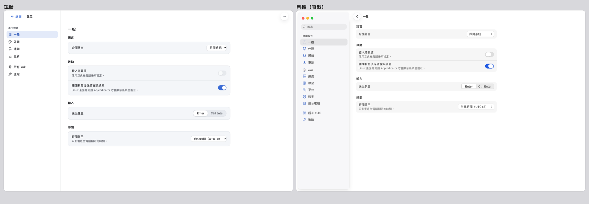
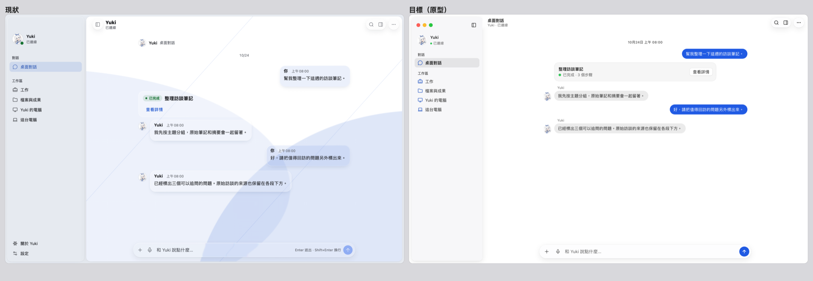
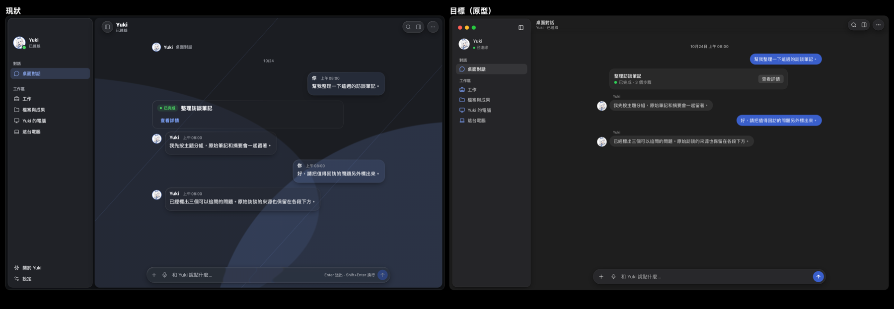
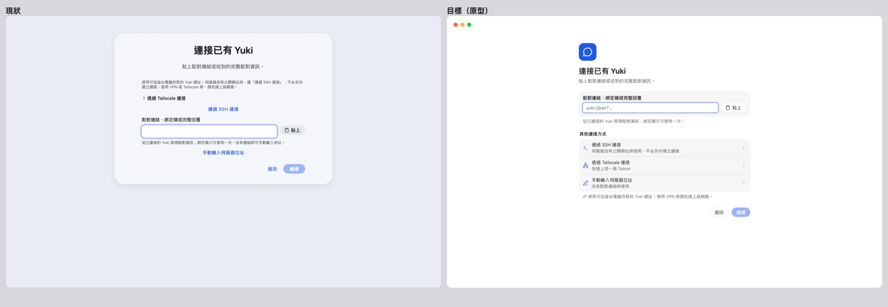
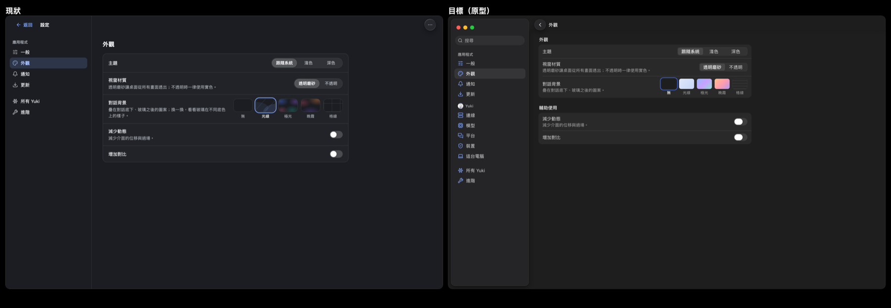
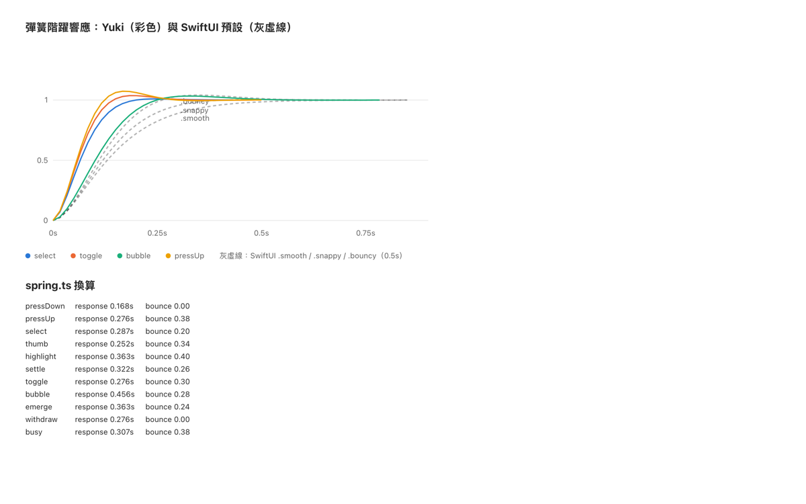

# 對照 Apple HIG（2025/26 Liquid Glass）的介面審查（2026-11-23）

本文件只做調研與原型，不改正式介面。原型是測試 fixture 頁，不接入應用；正式實作另開任務。蘋果的圖片與影片幀有版權，只留在本地比對，不進倉庫；本文的圖都是我們自己的截圖。

## 0. 結論先行

- **整體方向已經對了一半。** 浮動工具列膠囊、玻璃只放在導航／控制層的分層（`materials.css` 的 lens／pane／clear 三級）、深淺色與高對比、減少動態，都已經按 Liquid Glass 的想法做了。文字對比也已達標：以 fixture 實測，現有設定、對話與配對頁所有可見文字對比最低 4.64:1（淺色）／5.33:1（深色），都高於 4.5:1。
- **差距集中在「系統感」的細節**，按影響排序：
  1. 設定頁的結構與工作區不一致（側欄沒有內縮、沒有玻璃；「← 返回」用文字），配對頁是置中的玻璃卡片，兩者都偏離 HIG。
  2. 控制元件全是 28px 膠囊。macOS 26 起，mini／small／medium 控制仍是圓角矩形，只有 large 與新的 extra large 用膠囊（WWDC25 356、310；本機 AppKit 實測見 §4）。
  3. 內容層看起來像玻璃：氣泡與工作卡畫了玻璃邊光，對話預設疊「光線」背景圖案，配對頁卡片直接用玻璃。HIG 明確說「Don't use Liquid Glass in the content layer」。
  4. 工具列與輸入框用的是近乎 clear 的 lens（`blur(1px)`），浮在文字上。HIG 只建議在豐富媒體上用 clear，文字背景應該用 regular。
  5. 字級與圓角沒有收斂成 token：`tokens.css` 定義的 `--radius-*`、`--space-*` 全專案零引用，CSS 裡有 22 種圓角值、14 種字級。
  6. 圖示筆畫 `strokeWidth={1.5}`（16px 下約 1px）大約相當於 SF Symbols 的 Light，比 13px Regular 文字細；而且和預設 2 的圖示混用。
  7. 彈簧整體比 SwiftUI 預設快一倍、更彈（response 0.17–0.46s、bounce 最高 0.40；SwiftUI 預設是 0.5s，bounce 0／0.15／0.30）。
- **原型**：`tests/fixtures/hig-audit.html?page=settings|look|chat|pairing|tokens|motion&theme=dark`，樣式只在 `hig-audit.css` 內，以 HIG 字級、AppKit 實測顏色與控制尺寸、同心圓角規則作為 token。

> 現狀截圖來自既有 renderer fixture（`renderer-regressions.html?case=settings`、`?case=showcase`、`pairing-regressions.html`），設定 fixture 的平台是 `linux`，因此沒有紅綠燈的位置；原型畫了 macOS 紅綠燈。兩邊都是 1280×800、@2x。

## 1. 依據與方法

| 來源                                                                                                                                                                                                                                                                                                                                                                                                                                                                                                                                                                                                                                                                                                                                                                                                                                                                                                                                                                                                                                                     | 用途                                                                                                                                                           |
| -------------------------------------------------------------------------------------------------------------------------------------------------------------------------------------------------------------------------------------------------------------------------------------------------------------------------------------------------------------------------------------------------------------------------------------------------------------------------------------------------------------------------------------------------------------------------------------------------------------------------------------------------------------------------------------------------------------------------------------------------------------------------------------------------------------------------------------------------------------------------------------------------------------------------------------------------------------------------------------------------------------------------------------------------------- | -------------------------------------------------------------------------------------------------------------------------------------------------------------- |
| HIG [Typography](https://developer.apple.com/design/human-interface-guidelines/typography)、[Color](https://developer.apple.com/design/human-interface-guidelines/color)、[Materials](https://developer.apple.com/design/human-interface-guidelines/materials)、[Layout](https://developer.apple.com/design/human-interface-guidelines/layout)、[Buttons](https://developer.apple.com/design/human-interface-guidelines/buttons)、[Toggles](https://developer.apple.com/design/human-interface-guidelines/toggles)、[Segmented controls](https://developer.apple.com/design/human-interface-guidelines/segmented-controls)、[Sidebars](https://developer.apple.com/design/human-interface-guidelines/sidebars)、[Toolbars](https://developer.apple.com/design/human-interface-guidelines/toolbars)、[Sheets](https://developer.apple.com/design/human-interface-guidelines/sheets)、[Menus](https://developer.apple.com/design/human-interface-guidelines/menus)、[SF Symbols](https://developer.apple.com/design/human-interface-guidelines/sf-symbols) | 官方規範原文（取自 `…/tutorials/data/design/human-interface-guidelines/<page>.json`，2026-11-23 抓取）                                                         |
| WWDC25 [356 Get to know the new design system](https://developer.apple.com/videos/play/wwdc2025/356/)、[219 Meet Liquid Glass](https://developer.apple.com/videos/play/wwdc2025/219/)、[310 Build an AppKit app with the new design](https://developer.apple.com/videos/play/wwdc2025/310/)                                                                                                                                                                                                                                                                                                                                                                                                                                                                                                                                                                                                                                                                                                                                                              | 同心圓角、控制形狀、捲動邊緣效果、regular／clear 的官方講法（逐字稿）                                                                                          |
| SwiftUI 文件 `Animation.smooth/snappy/bouncy`、`Spring(duration:bounce:)`、`interactiveSpring`                                                                                                                                                                                                                                                                                                                                                                                                                                                                                                                                                                                                                                                                                                                                                                                                                                                                                                                                                           | 彈簧預設值                                                                                                                                                     |
| 本機 AppKit（macOS 27.0，build 26A425）                                                                                                                                                                                                                                                                                                                                                                                                                                                                                                                                                                                                                                                                                                                                                                                                                                                                                                                                                                                                                  | 用 Swift 讀取 `NSColor` 動態系統色的 sRGB 值，並把 `NSButton`／`NSSegmentedControl`／`NSPopUpButton`／`NSTextField`／`NSSwitch` 各尺寸離屏繪製後量測高度與圓角 |
| fixture 實測                                                                                                                                                                                                                                                                                                                                                                                                                                                                                                                                                                                                                                                                                                                                                                                                                                                                                                                                                                                                                                             | 現狀與原型的文字對比（按圖層疊色後計算）、900px 是否橫向溢出、控制尺寸                                                                                         |

AppKit 量測的數字是本機系統畫出來的結果，HIG 沒有公布；系統更新可能改變，正式實作前應在目標系統上重量一次。

## 2. 字體與字級

**現狀**

- 字體鏈：`src/renderer/tokens.css:18-21`，`-apple-system, BlinkMacSystemFont, 'PingFang TC', …, 'Segoe UI Variable Text', 'Segoe UI', 'Microsoft JhengHei UI', system-ui, 'Noto Sans CJK TC', …`；簡中另有一組（`:163-172`）。macOS 上拉丁字是 SF Pro，漢字是蘋方，方向正確。
- 基準 13px／18px（`tokens.css:86-88`），符合 macOS 預設 13pt。
- 標題：`h1` 28/34、`h2` 17/22、`h3` 15/20、`small` 11/14（`tokens.css:429-445`）。設定頁頁名用 `h2` 17/22（`Settings.module.css:132-136`），工具列標題 15/20 600（`App.module.css:229-238`）。
- 全專案 CSS 有 14 種字級，12px 出現 53 次、13px 與 11px 各 39 次，另有 `12.5px`（`Conversation.module.css:199`、`Files.module.css:192`、`Media.module.css:137`）。
- 按鈕字距 `letter-spacing: 0.03em`（`Controls.module.css:18`），理由是漢字太擠。

**HIG 目標**

- macOS 預設 13pt、最小 10pt；macOS 不支援 Dynamic Type（Typography › Ensuring legibility、Platform considerations）。
- macOS 內建文字樣式：Large Title 26/32、Title 1 22/26、Title 2 17/22、Title 3 15/20、Headline 13/16 Bold、Body 13/16、Callout 12/15、Subheadline 11/14、Footnote 10/13、Caption 10/13（Typography › Specifications）。
- 避免 Ultralight／Thin／Light 等細字重。
- WWDC25 356：字體「更粗、靠左」，用於提示與引導流程等關鍵時刻。
- 工具列標題要短（15 字內），而且不要用 App 名當標題（Toolbars › Titles）；HIG Toolbars 配圖裡 macOS Notes 的工具列是粗體標題加小字副標題（「Notes / 103 notes」，字級為目測，約 13pt 與 11pt）。

**差距與建議**

| 項目             | 現狀                                                         | 建議                                                                                                                                                                                                                                                                                               |
| ---------------- | ------------------------------------------------------------ | -------------------------------------------------------------------------------------------------------------------------------------------------------------------------------------------------------------------------------------------------------------------------------------------------- |
| 字級 token       | 散落各 CSS module 的數字                                     | 定義八級：`--t-large-title 26/32`、`--t-title1 22/28`、`--t-title2 17/22`、`--t-title3 15/20`、`--t-headline 13/18 600`、`--t-body 13/18`、`--t-callout 12/16`、`--t-subheadline 11/14`。漢字的行高比 SF 的 16 多 2px，保留目前的 18。逐步把字級寫死的地方換成 token，`12.5px` 直接併入 12 或 13。 |
| `h1`             | 28/34                                                        | 26/32（Large Title）或 22/28（Title 1）。引導頁用 Title 1 粗體靠左。                                                                                                                                                                                                                               |
| 工具列標題       | 15/20 600                                                    | 13/16 粗體加 11/14 副標題（如「桌面對話」/「Yuki · 已連線」）。設定頁可用 Title 3 15/20 當頁名。                                                                                                                                                                                                   |
| 說明文字         | 12/18                                                        | 12/16（Callout）；設定列的說明是 12 還是 HIG 的 11，見 §11 決策 7。                                                                                                                                                                                                                                |
| 按鈕字距 +0.03em | 有                                                           | SF 在 13pt 的標準字距是 −0.08pt（Tracking values 表）。原生應用會自動處理，Chromium 在 Mac 上不套用 SF 的 `trak` 表。混排漢字時不建議設負字距；+0.03em 是否保留見 §11。                                                                                                                            |
| 細字重           | 歡迎頁 `Snowflake strokeWidth={1}` 96px（`Pairing.tsx:188`） | 依 HIG 避免細字重，大圖示改用 Regular 以上的筆畫。                                                                                                                                                                                                                                                 |

## 3. 顏色與強調色

**AppKit 實測的動態系統色（本機 macOS 27）**

| 名稱                                                | 淺色                            | 深色                            |
| --------------------------------------------------- | ------------------------------- | ------------------------------- |
| `labelColor`                                        | `rgba(0,0,0,.847)`              | `rgba(255,255,255,.847)`        |
| `secondaryLabelColor`                               | `rgba(0,0,0,.498)`              | `rgba(255,255,255,.549)`        |
| `tertiaryLabelColor`                                | `rgba(0,0,0,.259)`              | `rgba(255,255,255,.247)`        |
| `separatorColor`                                    | `rgba(0,0,0,.098)`              | `rgba(255,255,255,.098)`        |
| `systemFill`／`secondary`／`tertiary`／`quaternary` | 黑 .098／.078／.047／.027       | 白，同樣的 alpha                |
| `windowBackgroundColor`                             | `#FFFFFF`                       | `#1E1E1E`                       |
| `systemBlue`                                        | `#0088FF`                       | `#0091FF`                       |
| `controlAccentColor`（使用者預設藍）                | `#007AFF`                       | —                               |
| `linkColor`                                         | `#0068DA`                       | `#419CFF`                       |
| `systemGreen`／`Red`／`Orange`                      | `#34C759`／`#FF383C`／`#FF8D28` | `#30D158`／`#FF4245`／`#FF9230` |

`systemBlue` 等值與 HIG Color › Specifications 2025-06 更新後的色票一致。

**現狀**

- 文字：`--text-primary #1b1c20`、`--text-secondary #5b5e66`、`--text-tertiary #5f626a`（`tokens.css:39-42`）。第三級文字和第二級幾乎一樣深，所以層級只剩兩級；好處是對比高。
- 強調色：預設 `#3a6bd6`／深色 `#7fa4ff`（`tokens.css:46`、`:191`），進入對話後換成角色資料的 `accent`（`Conversation.tsx:686-713`）。主要按鈕的填色是 `oklch(from var(--accent) min(l,0.52) calc(c*1.35) h)`（`Controls.module.css:248-255`），確保白字對比至少 4.5:1，這一點做得比系統還仔細。
- 狀態色（`tokens.css:50-55`）是自訂的深色版本，狀態膠囊是彩色字加 12% 同色底（`Controls.module.css:111-124`）。
- 側欄選中項是強調色文字加強調色淺底（`App.module.css:181-184`、`Settings.module.css:73-77`）。
- 沒有讀取系統強調色（main 程序沒有 `systemPreferences.getAccentColor()`）。

**HIG 目標**

- 用語義色（label／secondary label／separator／fill），不要挪用語義（Color › System colors）。
- Liquid Glass 本身無色；只在真正需要強調的地方上色（主要操作、狀態）。主要操作要把顏色放在背景，不是放在文字或符號上（Color › Liquid Glass color）。
- 側欄圖示預設用 App 強調色；使用者在系統設定改強調色時，所有側欄圖示應跟著變（Color › App accent colors；Sidebars）。
- 不要只靠顏色傳達資訊（Color › Inclusive color）。

**差距與建議**

1. **改成「透明度疊加」的標籤與填色 token**（原型的 `--label`、`--label-2`、`--fill-1…4`、`--separator`），疊在玻璃或彩色背景上也會自動配合。第二級標籤刻意從 AppKit 的 .50 提高到 .62：.50 黑在白底只有約 3.9:1，不到正文 4.5:1；原型以 .62 實測最低 5.78:1。這是有意偏離系統值，見決策 9。
2. **狀態色用系統色畫在圓點或圖示上，文字維持標籤色**，例如原型工作卡的「● 已完成 · 3 個步驟」。`#34C759` 這類系統色當文字在白底只有約 2.2:1，不能直接拿來當字色；現有的深色狀態字色可以保留給必須上色的文字。
3. **側欄選中狀態**：原型用中性填色、標籤色粗體、強調色圖示，接近 Finder 側欄「圖示帶色、文字不帶色」的做法。要不要沿用現在的強調色字，見決策 1。
4. **強調色來源**：角色 accent 是品牌，也是區分多個 Yuki 的線索，建議保留。可選在使用者把系統強調色設為非「多色」時改跟系統色（`systemPreferences.getAccentColor()`，macOS／Windows 都有）。這是產品決策，見決策 1。
5. 若預設改用系統藍：`#0088FF` 在白底對比約 3.5:1，只能用在填色上，文字要用 `linkColor #0068DA` 這一級，或沿用現有的 oklch 壓暗公式。

## 4. 間距、圓角與同心

**WWDC25 356 原文要點**：形狀靠「同心」嵌套。共有三種形狀：fixed（固定半徑）、capsule（半徑 = 高度 / 2）、concentric（半徑 = 父層半徑 − 間距）。膠囊天生同心，所以滑桿、開關、列、按鈕、分組列表的圓角都用它。但在密集的桌面環境中，膠囊最好留給醒目的操作：macOS 的 mini／small／medium 控制繼續用圓角矩形，large 改用膠囊，新增 extra large。WWDC25 310 補充：視窗圓角變大，帶工具列的視窗用更大的半徑包住玻璃工具列。

**本機 AppKit 實測**（離屏繪製；半徑是擬合值，±0.5pt）

| 尺寸        | 按鈕高 | 按鈕圓角   | 分段控制 | 彈出選單 | 開關（繪製尺寸） |
| ----------- | ------ | ---------- | -------- | -------- | ---------------- |
| mini        | 16     | ≈4         | 16，≈4   | 16       | 36×16            |
| small       | 20     | ≈5         | 20，≈4   | 20       | 44×20            |
| regular     | 24     | ≈5.5       | 24，≈4   | 24，≈5.5 | 54×24            |
| large       | 28     | 14（膠囊） | 28，膠囊 | 28，膠囊 | 64×28            |
| extra large | 36     | 18（膠囊） | 36，膠囊 | 36，膠囊 | 80×36            |

文字欄位最高只到 24（large／XL 不再變高），圓角約 6。分段控制的選中段在 macOS 27 是強調色實心。

**現狀**

- 按鈕全是 `border-radius: 999px`、最小高 28（`Controls.module.css:13-15`），`.large` 是 36（`:50-56`），圖示按鈕 28 圓形（`:57-67`）。
- 欄位 28 高、圓角 8（`tokens.css:303-319`）；分段控制 30 高膠囊（`InteractiveControls.module.css:1-7`）；開關 38×22（`:49-53`）。
- 視窗內板塊：側欄、主區外距 6、圓角 14（`App.module.css:103-117`、`:188-204`），相當於假設視窗圓角是 20。設定分組圓角 12 加邊框（`Settings.module.css:137-143`）；對話框 22（`Controls.module.css:143-153`）；歡迎卡 28（`App.module.css:23-38`）；輸入框 22（`:268-287`）。
- `tokens.css:56-73` 定義的 `--radius-*`、`--space-*` 全專案零引用；CSS 裡實際有 22 種圓角值，最常見的是 8px（22 次）、10px（12 次）、12px（11 次）。

**建議**

1. **控制尺寸政策**：密集區（設定列、檢閱器、對話框內的次要操作）用 regular 24px 圓角矩形（半徑 6）；頁面級主次操作用 large 28px 膠囊；引導頁唯一的主行動用 XL 36px 膠囊。原型的 `--h-regular/large/xl` 與 E2E 會核對這三種（24/6、28/14、36/18）。
2. **同心 token**：`--r-window`（實測後填入）、`--inset`、`--r-pane: calc(var(--r-window) - var(--inset))`；貼近板塊角落的元素用 `calc(var(--r-pane) - 間距)` 或膠囊。原型：視窗 20 − 內縮 8 = 側欄 12，E2E 會核對。
3. **先量視窗圓角**：Electron `titleBarStyle: 'hiddenInset'`（`src/main/windows.ts:41`）在 macOS 26 拿到的系統圓角沒有公開數字。用既有 `mac-material-contrast.spec.ts` 的 CGWindowID 擷取量一次，再決定 `--r-window`；之後 6／14 這組要按公式重算。
4. **刪除或啟用死 token**：按 AGENTS 的「刪除優先」，要嘛把 `--radius-*`／`--space-*` 換成上面這組並落地，要嘛先刪掉，不要留兩套。

## 5. 控制元件

| 元件             | 現狀（檔案）                                                                               | HIG／實測目標                                                                                                      | 建議                                                                                                                             |
| ---------------- | ------------------------------------------------------------------------------------------ | ------------------------------------------------------------------------------------------------------------------ | -------------------------------------------------------------------------------------------------------------------------------- |
| 按鈕             | 全部膠囊 28；主要按鈕是強調色底、白字、邊光（`Controls.module.css`）                       | 每個畫面最多一到兩個醒目按鈕；用樣式而不是尺寸區分主次（Buttons › Best practices）；macOS 圓角矩形／膠囊依尺寸而定 | 依 §4 分尺寸；次要按鈕改成白底（深色為 10% 白）加 0.5px 邊，不再用灰色填色膠囊                                                   |
| 開關             | 38×22，拇指在操作時變玻璃（`InteractiveControls.tsx:18`、`:91`）                           | 開關只用在列表列中；分組表單內用較小的開關（Toggles › macOS）；操作中變玻璃正是 HIG 允許的例外（Materials）        | 保留操作時的玻璃。尺寸是否跟系統（regular 54×24）或用 small 44×20，見決策 10；原型用 40×22                                       |
| 分段控制         | 30 高膠囊，選中段是白色滑塊（`InteractiveControls.module.css:1-40`）                       | 主視窗的視圖切換用 tab view，分段控制用於工具列或檢閱器（Segmented controls › macOS）；regular 24 圓角             | 設定列內改成 24 高、圓角 6；選中段用白色滑塊（原型）或系統的強調色實心，二選一                                                   |
| 文字欄位／選單   | 28 高、圓角 8；`<select>` 用瀏覽器樣式                                                     | 24 高、圓角 ≈6；彈出選單右側有上下箭頭                                                                             | 原型 `.h-popup`；欄位在引導頁可保留 28                                                                                           |
| 分組列表（設定） | 1px 邊框、`--bg-raised` 底、列高 48（`Settings.module.css:137-151`）                       | grouped form：只有底色沒有邊框，分隔線從文字起點開始                                                               | 原型 `.h-form`：`--grouped` 填色、圓角 10、列高 40、分隔線縮排 12                                                                |
| 側欄             | 工作區：外距 6 的實色圓角板；設定頁：滿高加右邊框，沒有內縮（`Settings.module.css:48-54`） | 側欄是浮在內容上的玻璃板（WWDC25 356／310）；不要把重要操作放在側欄底部（Sidebars › macOS）                        | 兩處統一成內縮玻璃板（原型）；「關於」「設定」從側欄底部（`Workspace.tsx:262-276`）移到 App 選單（⌘,）和工具列「更多」，見決策 3 |
| 工具列           | 浮動玻璃膠囊組 34 高、間距 2（`Controls.module.css:369-382`），方向正確                    | 同組共用一塊玻璃，符號不加邊框；返回／關閉用標準符號，不寫「返回」文字（Toolbars）                                 | 設定頁「← 返回」（`Settings.tsx:211`）改成玻璃上的 chevron 加提示文字；標題字級見 §2                                             |
| Sheet／對話框    | 圓角 22、pane 玻璃、底部分隔線與按鈕列（`Controls.module.css:143-191`）                    | 大量文字的元件（提示、側欄、popover）用 regular（Materials）；macOS sheet 會讓父視窗變暗                           | 保留玻璃與遮罩；去掉頁尾分隔線，主按鈕放在最後，用 large 膠囊                                                                    |
| 選單             | 自繪 `ApplicationMenu`（圓角 8）                                                           | macOS 26 的選單大量用圖示，每組圖示排成一欄；同一組要嘛全有圖示，要嘛都沒有（Menus；WWDC25 310）                   | 原生選單在 macOS 上加 SF Symbols（見 §7）；自繪選單同組圖示對齊成一欄                                                            |

## 6. 材質層級

**HIG**：Liquid Glass 只用在導航／控制層，浮在內容上；內容層用標準材質。例外是滑桿、開關等暫時性互動元件，操作中可以變玻璃。regular 會模糊並調整亮度，多數系統元件都用它；clear 高度透明，只用在照片、影片等豐富媒體上，亮的媒體要再加 35% 暗化層。regular 與 clear 不可混用，也避免玻璃疊玻璃（Materials；WWDC25 219）。WWDC25 356 另說：捲動邊緣效果分 soft／hard，macOS 主要用 hard。

**現狀對照**

| 介面                               | 現在的材質                                                                                        | HIG 歸屬                                               | 建議                                                                                                                                              |
| ---------------------------------- | ------------------------------------------------------------------------------------------------- | ------------------------------------------------------ | ------------------------------------------------------------------------------------------------------------------------------------------------- |
| 工具列按鈕組、輸入框               | `--glass-lens` = `blur(1px) saturate(116%)`（`materials.css:9`），輸入框底色只有 16%              | 導航層，但下面是文字 → regular                         | 改用 regular：模糊 σ 約 4pt（前一份報告在 HIG 圖上量到等效 σ≈4.3pt）加亮度調整；clear 只留給「Yuki 的電腦」等媒體上的控制（`--glass-clear` 已有） |
| 對話框、命令面板、選單、角色切換卡 | `--glass-pane` `blur(24px)`                                                                       | regular，文字多                                        | 保留；模糊可以降到接近 regular 的實測值，同時省 GPU                                                                                               |
| 側欄                               | 實色 `--bg-sidebar`；系統磨砂時是 16% 洗色                                                        | 大型導航玻璃，應較不透明（Color：側欄「more opaque」） | 原型 `--glass-large`（淺 86%、深 84%）加模糊與邊光                                                                                                |
| 訊息氣泡、工作卡                   | `ConversationGlass` 畫邊光與 tint（`ConversationGlass.tsx:3-5`、`Conversation.module.css:60-75`） | 內容層                                                 | 改成實心填色：對方是 `--fill-2`，自己是強調色底加白字（原型），不畫邊光                                                                           |
| 對話背景圖案                       | 預設「光線」（`shared/desktop.ts:51`、`Conversation.module.css:1-20`）                            | 內容層裝飾，原本是為了讓玻璃看得出來                   | 預設改成「無」；圖案是否保留為選項，見決策 4                                                                                                      |
| 配對／歡迎卡                       | `data-glass="card"` 加 `--glass-pane`（`Pairing.tsx:186`、`App.module.css:23-38`）                | 內容層                                                 | 去掉卡片與玻璃，直接排在視窗底色上，標題靠左（原型）                                                                                              |
| 捲動邊緣                           | `EdgeFade` 是 soft（模糊加洗色）；不透明模式才有實線（`App.module.css:224-228`）                  | macOS 建議 hard                                        | 工具列下改成一條等高、不漸隱的 hard 邊；預設模式保留 soft 也行，兩者不要疊加                                                                      |

原型只在 `.h-sidebar`、工具列按鈕組與輸入框用玻璃；E2E 會核對內容區沒有任何 `.h-glass` 元素。

## 7. 圖示

**授權**

- SF Symbols 不可用在非 Apple 平台；Windows／Linux 版不能用，也不能把向量匯出後打包。字型方面，Apple San Francisco 授權第 2 條只允許為 iOS／OS X／tvOS 軟體做介面模型，並且「You may not embed the Apple Font in any software programs」（<https://developer.apple.com/fonts/> 頁尾授權全文）。SF Symbols 的授權隨 SF Symbols App 安裝包提供，本機沒有安裝，這次沒有取得全文。正式採用前請 owner 從 App 包核對；以往版本把 SF Symbols 視為 Xcode／SDK 授權下的系統提供影像，只能用在 Apple 平台的 App。
- **macOS 上能用原生 SF Symbols 嗎**：可以。Electron 42 的 `nativeImage.createFromNamedImage('square.and.pencil')` 支援 SF Symbols 名稱（`node_modules/electron/electron.d.ts:9840-9863`）。產生的是 main 程序的點陣圖，適合用在原生選單項目、托盤與 Dock 選單。Renderer 裡若要用，得經 IPC 傳 data URL，拿不到可變字重或同步著色，也會讓三個平台維護兩套圖示。建議只在 macOS 原生選單用 SF Symbols（正好對上 macOS 26「選單用圖示」的新指引），renderer 繼續用跨平台圖示庫。

**替代圖示庫比較**

| 圖示庫                              | 授權       | 字重                                                           | 外觀接近 SF 的程度                                                                |
| ----------------------------------- | ---------- | -------------------------------------------------------------- | --------------------------------------------------------------------------------- |
| Lucide（現用，lucide-react 1.59.0） | ISC        | 可調連續筆畫（`strokeWidth`、`absoluteStrokeWidth`），只有線框 | 圓頭圓角、24 網格，造型接近 SF 的 Regular；沒有填色版，選中態只能靠顏色           |
| Phosphor                            | MIT        | 6 種：thin／light／regular／bold／fill／duotone                | 字重分級最像 SF 的九級概念，有填色版可表示選中；整體比 SF 圓、比 SF 寬            |
| Material Symbols                    | Apache 2.0 | 可變字型：字重 100–700、填色、grade、光學尺寸                  | 技術能力最接近 SF（可變字重、填色軸），但造型是 Google 風格，混在 SF 文字旁最顯眼 |
| Tabler Icons                        | MIT        | 筆畫可調；有部分填色版                                         | 與 Lucide 類似，數量更多                                                          |

**建議**：維持 Lucide，不換庫。統一筆畫：16px 下 `strokeWidth` 2 約 1.33px，最接近 13px Regular 文字旁的 SF Symbols；目前 22 處是 1.5（約 1px，接近 Light），與預設 2 混用。選中或粗體文字旁用 2.25。圖示一律跟著文字顏色，側欄圖示用強調色。需要「填色選中態」時，再評估局部引入 Phosphor（MIT）。

## 8. 動態

**SwiftUI 官方預設**：`.smooth` = duration 0.5、bounce 0；`.snappy` = 0.5、0.15；`.bouncy` = 0.5、0.30（文件：`smooth(duration:extraBounce:)` 等，「base bounce of 0／0.15／0.3」）；`Animation.spring` 預設 0.5、0；`interactiveSpring(response: 0.15, dampingFraction: 0.86)`。換算：單位質量下 `k = (2π/duration)²`，阻尼比 = 1 − bounce（bounce ≥ 0）。duration 0.5 → k ≈ 158。

**現狀**（`src/renderer/motion/spring.ts:1-13`，`drag = 2·damping·√k`，damping 就是阻尼比）

| 彈簧      | response | bounce | 對照                    |
| --------- | -------- | ------ | ----------------------- |
| pressDown | 0.168s   | 0      | ≈ interactiveSpring     |
| pressUp   | 0.276s   | 0.38   | 比 .bouncy 更彈         |
| select    | 0.287s   | 0.20   | 接近 snappy，但快約一倍 |
| thumb     | 0.252s   | 0.34   |                         |
| highlight | 0.363s   | 0.40   | 最彈                    |
| settle    | 0.322s   | 0.26   |                         |
| toggle    | 0.276s   | 0.30   | = .bouncy 的彈性        |
| bubble    | 0.456s   | 0.28   |                         |
| emerge    | 0.363s   | 0.24   |                         |
| withdraw  | 0.276s   | 0      |                         |
| busy      | 0.307s   | 0.38   |                         |

CSS 另有 `--motion-fast/base/slow 120/180/240ms` 與帶過衝的 `--ease-pop`（`tokens.css:74-81`）。

**建議**

1. 彈簧參數改用 `{ duration, bounce }` 表示，與 SwiftUI 的心智模型一致，內部再換算成 k 與阻尼比。保留現有積分器，因為它已能與速度銜接。
2. 預設過場用 snappy 類（duration 0.3–0.35、bounce ≤ 0.15）。桌面比觸控更密集，可以比 iOS 的 0.5 快，但彈性應該收斂。直接操作的放手回彈（thumb、pressUp、toggle）可保留到 0.2–0.3；`highlight` 與 `busy` 的 0.38–0.40 建議降到 ≤ 0.2。前一份報告在 WWDC25 219 的分享按鈕上量到：放手約 0.16s 回到原尺寸，看不出過衝。
3. `--ease-pop` 的過衝改用與彈簧相同的參數生成 `linear()` 緩動，避免 CSS 與 JS 兩套手感。
4. 減少動態已處理（`tokens.css:449-464`），保持。

## 9. Windows／Linux

**結論**：維持一套 Apple 系的版面與元件，各平台只換字體、視窗按鈕、系統材質與少量尺寸，不另做 Fluent／Adwaita 版本。視窗按鈕與 Mica 已有處理（`App.module.css:245-253`、`tokens.css:243-253`）。

| 平台       | 字體鏈（建議）                                                                                                                  | 授權                                                                     | 備註                                                                                                          |
| ---------- | ------------------------------------------------------------------------------------------------------------------------------- | ------------------------------------------------------------------------ | ------------------------------------------------------------------------------------------------------------- |
| macOS      | `-apple-system`（SF Pro，系統提供）→ `PingFang TC/SC` → `Hiragino Sans`                                                         | 皆為系統字型，只呼叫不打包；SF 授權禁止嵌入                              | 現狀已正確                                                                                                    |
| Windows 11 | `Segoe UI Variable Text` → `Segoe UI` → `Microsoft JhengHei UI`／`Microsoft YaHei UI`                                           | 隨系統提供，不得再散布                                                   | Fluent 正文是 14px；我們 13px 是否在 Windows 改成 14，見決策 6                                                |
| Linux      | `system-ui`（fontconfig 預設，如 GNOME 的 Adwaita Sans、Cantarell 或 Noto Sans）→ `Inter` → `Noto Sans` → `Noto Sans CJK TC/SC` | Inter、Noto Sans、Noto Sans CJK、Adwaita Sans 都是 SIL OFL 1.1，可以打包 | CJK 字檔很大，建議依賴發行版的 Noto CJK，不要打包；要統一拉丁字形時，只打包 Inter 可變字型（woff2 約數百 KB） |

其他：Linux 沒有系統強調色 API，用角色 accent；Windows 可讀 `systemPreferences.getAccentColor()`。圖示三平台都用 Lucide；SF Symbols 只用在 macOS 原生選單。

## 10. 分階段實作清單（估時以一人日計）

| 階段         | 內容                                                                                                                                                        | 估時 | 驗證                                                                                                |
| ------------ | ----------------------------------------------------------------------------------------------------------------------------------------------------------- | ---- | --------------------------------------------------------------------------------------------------- |
| 0 量測與決策 | 在 macOS 26／27 實機量 Electron 視窗圓角與系統側欄內縮；owner 對 §11 的決策拍板                                                                             | 0.5  | `mac-material-contrast.spec.ts` 的視窗擷取                                                          |
| 1 Token      | 字級八級、標籤與填色 alpha token、同心圓角 token、控制高度 token；刪除未用的 `--radius-*`／`--space-*`；把寫死的字級與圓角換成 token（約 30 個 CSS module） | 2–3  | 既有視覺 E2E 加 hig-audit 的對比與 900px 檢查                                                       |
| 2 控制元件   | 按鈕分尺寸（regular 圓角／large 膠囊／XL）、分段控制、欄位與 `<select>` 樣式、開關尺寸、設定分組改成 grouped form                                           | 2–3  | `button-fit.spec.ts`、`components.spec.ts`、`pairing-visual.spec.ts` 中寫死 28／36px 的斷言要一起改 |
| 3 結構       | 設定頁側欄內縮成玻璃板、返回改 chevron、工具列標題 13/11、側欄底部項目移走、配對頁去卡片並靠左                                                              | 2–3  | `settings`／`entry`／`pairing-visual`／`language-layout` 等 E2E 與三語截圖                          |
| 4 材質       | 工具列與輸入框改 regular、macOS 用 hard 捲動邊緣、氣泡與工作卡改實心、預設背景改成「無」                                                                    | 2–4  | `glass-slices.spec.ts` 的效能預算、`frosted-workspace`、`conversation-glass`、深淺色與高對比截圖    |
| 5 圖示與選單 | 筆畫統一為 2／2.25；macOS 原生選單加 SF Symbols                                                                                                             | 1–2  | 原生選單截圖（`native-message-copy` 一類，需互動桌面）                                              |
| 6 動態       | 彈簧改用 duration／bounce，重新調參；`--ease-pop` 改用 `linear()`                                                                                           | 1–2  | `control-motion.spec.ts`、`liquid-morph.spec.ts`                                                    |
| 7 跨平台     | 字體鏈、Windows 字級、Linux 是否打包 Inter                                                                                                                  | 1    | `languages.spec.ts`、Windows 原生專項                                                               |

合計約 12–19 人日。每階段可以單獨交付；建議依 1 → 2 → 3 的順序做，4 與 6 可以並行。

## 11. 需要 owner 決定

1. **強調色**：一律用角色 accent（現狀），還是在使用者設了非「多色」的系統強調色時改跟系統？側欄選中用強調色字（現狀），還是中性底加強調色圖示（原型）？
2. **設定的位置**：維持視窗內頁面（原型），還是改成 macOS 慣例的獨立設定視窗（⌘,）？
3. **側欄底部的「關於」「設定」**：依 HIG 移到 App 選單與工具列「更多」，還是保留？
4. **對話外觀**：氣泡改實心（自己是強調色、對方是灰）、預設背景改成「無」；背景圖案是否保留為選項？
5. **工具列與輸入框的玻璃**：改 regular（可讀性更好、更像系統），還是保留目前接近 clear 的透鏡感（更有特色）？
6. **Windows／Linux 正文字級**：13px（三平台一致）還是 14px（Fluent 原生）？
7. **說明文字**：12px（原型，中文可讀性較好）還是 HIG 的 11px？
8. **控制尺寸政策**：照 §4（密集區 24 圓角、頁面級 28 膠囊、引導 XL 36）？
9. **第二級文字對比**：接受刻意偏離系統的 .62（保 4.5:1），還是照搬系統 .50？
10. **開關尺寸**：跟系統 regular（54×24），還是用較小的 small 44×20？
11. **按鈕漢字字距 +0.03em**：保留還是去掉？

## 12. 原型與驗證

- 原型：`tests/fixtures/hig-audit.html`、`hig-audit.tsx`、`hig-audit.css`（只讀引用 `src/renderer/motion/spring.ts`，不改正式碼）。
  - `?page=settings`、`look`、`chat`、`pairing`：三個關鍵頁的目標樣子。
  - `tokens`：字級、顏色、控制、同心規則。
  - `motion`：彈簧曲線與換算表。
  - 加 `&theme=dark` 看深色。
- E2E：`YUKI_LAB_OUTPUT=<目錄> npx playwright test tests/e2e/hig-audit-lab.spec.ts`。沒有設這個變數時整個檔案跳過，不進 CI。檔頭先列失敗情況，然後核對：
  - 六頁在淺深色下都能渲染、沒有錯誤；
  - 900px 寬時沒有橫向溢出；
  - 所有正文對比 ≥ 4.5:1（按圖層疊色計算）；
  - 控制尺寸符合 24/6、28/14、36/18；
  - 內容區沒有玻璃；
  - 側欄圓角 = 視窗圓角 − 內縮。

  產物有 `target-*`、`current-*`、`side-*` 截圖與 `hig-audit.json`。本次執行 2 項全部通過：正文最低對比 5.71:1（對話，深色），900px 下零溢出。

- 限制：
  - 原型是靜態樣子，沒有互動與動態。
  - 對比計算不含背景圖片與 `backdrop-filter`，所以現狀對話頁的圖案背景只是近似。
  - AppKit 數字只來自一台 macOS 27 機器。
  - 視窗圓角 20 是假設值，待階段 0 實測。
