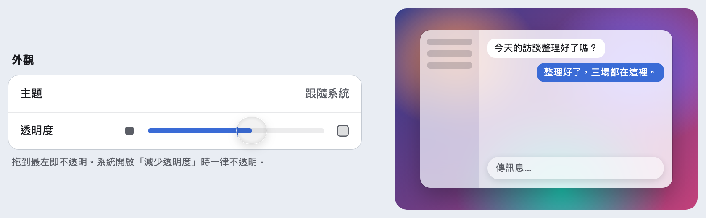
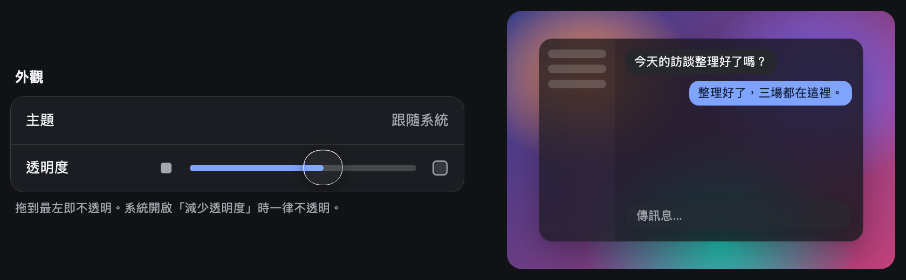

# 透明度滑塊 v2：照 iOS 26 / macOS 26 設定的液態玻璃滑塊重做（2026-11-23）

只做調研與原型，不改正式介面。第一版（`liquid-glass-lab.html?page=slider`，控制中心音量式的粗膠囊、飽和藍填充、自畫水滴圖示、按下時雙層藍色焦點環、下方灰色百分比）所有者不滿意：像網頁，也不是設定表單該有的樣子。v2 改成設定頁的一列：細軌道、強調色填充、玻璃滑塊，兩端放小圖示，不顯示數字。




## 1. 怎麼看

```sh
node node_modules/vite/bin/vite.js --config tests/fixtures/vite.config.ts
# http://127.0.0.1:4178/glass-slider.html
```

| 參數           | 作用                                                 |
| -------------- | ---------------------------------------------------- |
| `?theme=dark`  | 深色                                                 |
| `?value=0–100` | 起始透明度（預設 60）                                |
| `?shape=ios`   | 滑塊用 WWDC25 219 影片裡 iOS 滑塊的寬高比（見 §3.1） |
| `?mag=1.3`     | 讓按住的滑塊中間放大（只供對照；蘋果實測是 1.00）    |
| `?track=192`   | 指定軌道長度，和 HIG 圖等長並排用                    |

E2E：`YUKI_LAB_OUTPUT=<目錄> npx playwright test tests/e2e/glass-slider-lab.spec.ts`，沒設變數時跳過，不進 CI。產物寫在 `<目錄>/glass-slider/`：淺深色靜止與按住截圖、鍵盤焦點截圖、拖動逐幀 `sequence/`、放手後逐幀尺寸 `release.json`。

檔案：`tests/fixtures/glass-slider.html`、`glass-slider.tsx`（元件與頁面）、`glass-slider.css`、`glass-slider-lens.ts`（按住時的位移圖）。沿用 `src/renderer/motion/hooks.ts` 的 `useSprings`、`capturePointer`、`swallowDragClick`，`spring.ts` 的 `Spring`、`clamp`、`rubber`，`materials/glass.ts` 的 `roundedDistance` 和同一套 `feImage` + `feDisplacementMap` 掛在 `backdrop-filter: url(#…)` 的做法。

## 2. 量測來源與方法

蘋果素材有版權，不進倉庫，只在本機調研目錄（以下路徑相對 `…/scratchpad/`）：

- HIG Sliders：`apple-dl/hig/img/sliders-no-tick-marks@2x.png`（及 `~dark`）、`sliders-labels@2x.png`、`components-slider-intro@2x.png`；文字取自 developer.apple.com 的 HIG Sliders。
- WWDC25 219〈Meet Liquid Glass〉逐幀（29.97fps）：`liquid-glass/v3/apple-frames/219/motion/b_slider_finger_release/`（04:31.25–04:32.09 是正面平視的鏡頭，放手前後各十多幀）、`b_slider_glass_thumb_closeup/`、`b_toggle_flick/`。
- WWDC25 284〈Build a UIKit app with the new design〉：滑塊「拖動時保留動量並拉伸」、tick marks、neutral value、thumbless。
- 量測腳本在 `tools-slider/`：`hig_measure.py`／`hig_thumb.py`（HIG 圖的軌道、滑塊、顏色）、`thumb_fit.py`（每幀用加權最小平方擬合一個膠囊，得中心、寬、高）、`release_fit.py`／`frost_fit.py`（擬合阻尼彈簧）、`lens_mag.py`（滑塊內外的軌道粗細）、`curve_plot.py`。
- 對照圖與 `comparison.md`：`liquid-glass/v4-slider/`。

換算：HIG 圖是 @2x；影片以軌道粗細換算（34px = 6pt，即 5.67px/pt）。原型中 1pt = 1 CSS px。

## 3. 設計與實測數字

### 3.1 尺寸

| 項目       | 蘋果                                                                               | 原型                                                                                       |
| ---------- | ---------------------------------------------------------------------------------- | ------------------------------------------------------------------------------------------ |
| 軌道       | 6pt（HIG @2x 12px，淺深相同），兩端全圓角                                          | 6pt                                                                                        |
| 靜止滑塊   | HIG：24×20pt（1.2:1），高為軌道 3.3 倍；219 的 iOS 滑塊：1.54:1，高為軌道 3.0 倍   | 預設 24×20；`?shape=ios` 31×20                                                             |
| 按住       | 219：寬 ×1.55、高 ×1.65（157×102 → 244×168px）                                     | 37×33（ios：48×33）                                                                        |
| 拖動中拉伸 | 速度約 86pt/s 時寬 ×1.17、高 ×0.83，面積幾乎不變；最大寬高比 2.08（按住不動 1.45） | 寬 = 1 + 0.002 × 速度(pt/s)，上限 1.2；高取倒數；停手 60ms 收回                            |
| 拉過端點   | 284：「拉伸」                                                                      | 滑塊跟過去 `rubber(距離, 6, 48)`，放手彈回                                                 |
| 端點圖示   | HIG 介紹圖：圖示外框約 2.6 倍軌道（≈16pt），距軌道約 2.4 倍（≈14pt），左小右大     | 16pt 框：左邊實心方塊（不透明），右邊半透明方塊（透明），間距 14pt；內嵌 SVG，不加圖示依賴 |

兩個蘋果來源的滑塊比例本身不同。預設取 HIG（規格圖，也較接近 HIG 對 macOS 滑塊「窄菱形」的描述）；`?shape=ios` 依影片。依影片時按住的形狀和蘋果最像（對照：`v4-slider/compare-wwdc-ios-shape.png`），請所有者選一種。

### 3.2 玻璃

- **按住時中心不放大**：影片裡按住不動的 7 幀，滑塊中間看到的填充 34.7px、外面 34.6px，放大 1.00 倍；特寫鏡頭也一樣。第一版和 `glass.ts` 的 `slider` 預設（中心約 1.47 倍）都放大，和蘋果不符。「放大鏡」感來自兩件事：整塊透明、看得到底下的軌道和填充；以及邊緣的折射。
- **邊緣折射**：填充在滑塊左緣捲成一道細弧，只在離邊 4px（0.05R）內，最遠到 0.48R 高。反推：最外緣的點看到往內約 0.6R 處的東西，0.1R 以內衰減到 0。原型的位移圖：倒角 0.1R、外緣位移 0.6R、剖面 (1 − 距邊/倒角)^0.5，中間平台位移 0。
- **靜止是實心**：淺色白色，深色 231 灰，都帶 0.5pt 白色細邊；按下時同一個彈簧把它變成透明玻璃（內部約暗 5%、邊緣淡淡的厚度陰影、亮邊），放手時再「結霜」回實心，過渡中有模糊（影片的過渡幀裡填充被糊開）。
- **陰影**：靜止時柔和的小陰影；按住時向下約 0.12 倍高、更大更淡（影片約 6% 暗）。

### 3.3 動畫（Spring：單位質量的剛度 k 與阻尼比 ζ，`spring.ts` 的寫法）

| 動作             | 蘋果                                                                       | 原型                                                       |
| ---------------- | -------------------------------------------------------------------------- | ---------------------------------------------------------- |
| 放手回到靜止尺寸 | 寬：k=151、ζ=0.69（response 0.51s）；高：k=174、ζ=0.69（0.48s）；下衝 5.2% | 設 k=165、ζ=0.69；實測擬合 k=171、ζ=0.70、0.48s，下衝 4.5% |
| 放手變回實心     | k=248、ζ=0.81（response 0.40s）                                            | 同                                                         |
| 按下變玻璃       | 開關鏡頭約 4 幀（0.13s）到全尺寸，手指遮擋，只能估                         | k=990、ζ=0.8                                               |

蘋果的回彈約等於 SwiftUI `.bouncy`（duration 0.5、bounce 0.3 ⇒ ζ = 0.7、k = (2π/0.5)² ≈ 158；換算依 WWDC23〈Animate with springs〉）。曲線對照：`v4-slider/release-curve.png`。

### 3.4 數值、焦點、互動

- **不顯示數字**：iOS 設定的亮度等滑塊不印數字；HIG 只對 macOS 建議「指標停在滑塊上時用 tooltip 顯示數值」。原型用 `title` 提示，讀屏用 `aria-valuetext`（0 時讀「不透明」）。
- **焦點環**：HIG Sliders 沒提焦點；macOS 只在鍵盤導航時畫強調色焦點環。原型：指標按下時以 `focus({ focusVisible: false })` 取得焦點，不畫環；Tab 進來才在滑塊外畫 3px 強調色環。
- **抓取**：抓在滑塊上任何位置都不跳值，按拖動距離改變；點在軌道其他位置，滑塊跳過去再拖（macOS NSSlider 的行為；iOS 只能拖滑塊）。
- **鍵盤**：←↓ −5、→↑ +5、PageDown/PageUp ±25、Home 0、End 100。
- **預覽**：右側小視窗只讀 `--window-transparency`，每次移動都改；0 時背景 100% 實色、模糊 0，當下就是不透明，不必等放手。

## 4. 套用到應用的方式

1. **偏好**：`src/shared/desktop.ts` 的 `Preferences.opaque: boolean` 改為 `transparency: number`（0–100，0 = 不透明）。預設值取現在「透明磨砂」的觀感（建議 70，下面的對應讓 70 正好等於今天的 token）。`src/main/store.ts` 的 `preferences()` 照現有 `backdrop: 'desktop'` 的遷移寫法：讀到舊的 `opaque` 時，`true → 0`、`false → 預設值`，然後丟掉 `opaque`。`diagnostics.ts` 一併改記 `transparency`。
2. **IPC**：`src/main/app.ts` 的 `yuki:preferences` 從布林清單拿掉 `opaque`，改收 `transparency`：是有限數字就 `Math.round` 後夾在 0–100，否則忽略。
3. **主程序材質**：`window-appearance.ts` 的 `opaque` 改為 `preferences.transparency === 0 || highContrast || 系統減少透明度 || 高對比`。vibrancy／Mica 只在 0 與大於 0 之間切換；透明多少全由渲染端 CSS 決定，主程序不跟著每個值重設材質。
4. **渲染端**：`App.tsx` 的 `data-opaque` 改由 `transparency === 0`（加原有的無障礙條件）得出。拖動時渲染端只在 `document.documentElement` 寫 `--window-transparency`（0–1），所有半透明 token（`tokens.css` 的 `--mat-sidebar`、`--surface-page`、`--surface-pane` 等）改寫為 `color-mix(in srgb, X calc(100% - (100% - 今日%) * var(--window-transparency) / 0.7), transparent)`，並以 `max()` 保證不低於 0%；放手（或每次按鍵）才呼叫一次 `window.yuki.preferences({ transparency })`。從 0 拖出來或拖回 0 時多送一次，讓主程序立刻開關 vibrancy；否則從 0 往右拖時，視窗後面仍是實色，要放手才透出桌面。
5. **元件**：設定頁「視窗材質」列的兩段 Segmented 換成這個滑塊。正式實作時把原型的 `GlassSlider` 併入 `InteractiveControls.tsx` 的 `Slider`（加 `minIcon`／`maxIcon`），`glass.ts` 的 `slider` 預設改成無中心放大、倒角 0.1R、外緣位移 0.6R，不必另寫位移圖；彈簧參數加進 `spring.ts` 的 `springs`。
6. **文案**（`src/shared/locales/*/settings.ts`，取代 `material`、`materialDescription`、`frost`、`opaque`）：

| 鍵                                                       | zh-Hant                                                                    | zh-Hans                                                                  | en                                                                                                                                              |
| -------------------------------------------------------- | -------------------------------------------------------------------------- | ------------------------------------------------------------------------ | ----------------------------------------------------------------------------------------------------------------------------------------------- |
| `transparency`                                           | 透明度                                                                     | 透明度                                                                   | Transparency                                                                                                                                    |
| `transparencyDescription`                                | 向右讓桌面透出更多；拖到最左即不透明。系統開啟「減少透明度」時一律不透明。 | 向右让桌面透出更多；拖到最左即不透明。系统开启“减少透明度”时一律不透明。 | Slide right to let more of the desktop show through; all the way left is opaque. Reduce Transparency in system settings always makes it opaque. |
| `transparencyOpaque`（讀屏與 tooltip 的 0）              | 不透明                                                                     | 不透明                                                                   | Opaque                                                                                                                                          |
| `transparencyValue`                                      | {{value}}%                                                                 | {{value}}%                                                               | {{value}}%                                                                                                                                      |
| `transparencyMin`／`transparencyMax`（圖示的無障礙名稱） | 不透明／透明                                                               | 不透明／透明                                                             | Opaque／Clear                                                                                                                                   |

## 5. 驗證

- `tests/e2e/glass-slider-lab.spec.ts`（`deviceScaleFactor: 2`）：先寫下的失敗情形——抓取不跳值、每次移動都改值與 CSS 變數且拖動中不提交、拖到最左即 0 且預覽當下實色、鍵盤方向鍵與 Home／End 可用且鍵盤焦點有環、放手 1 秒內回到 24×20 實心、指標按下後無焦點環——全部通過。放手到穩定 0.45s，只提交一次。
- `npx tsc --noEmit`、`npx eslint`（原型檔案）通過；原型檔案經 prettier。

## 6. 剩下的差距

1. 靜止滑塊比例：HIG 與 iOS 影片不同，待所有者選（§3.1）。
2. 邊緣折射：蘋果是 3D 渲染的厚玻璃，捲邊的細弧更長、更順，底緣還有軌道倒影和極淡彩邊；原型是一張 2D 位移圖，弧較短。
3. 玻璃內的明暗與亮邊是近似；深色模式沒有蘋果的按住素材可對照。
4. 按下的曲線是估計值（手指遮擋）。
5. 蘋果放手後滑塊還順著動量滑一小段（影片約 0.06 倍滑塊寬）；設定值不該在放手後再變，原型不滑行。
6. 填充依需求用應用強調色（淺 `#3A6BD6`），不是 iOS 的 systemBlue `#0088FF`（ΔE76 13.3）。若要跟系統強調色一致，主程序可把 `systemPreferences.getAccentColor()` 傳給渲染端。
